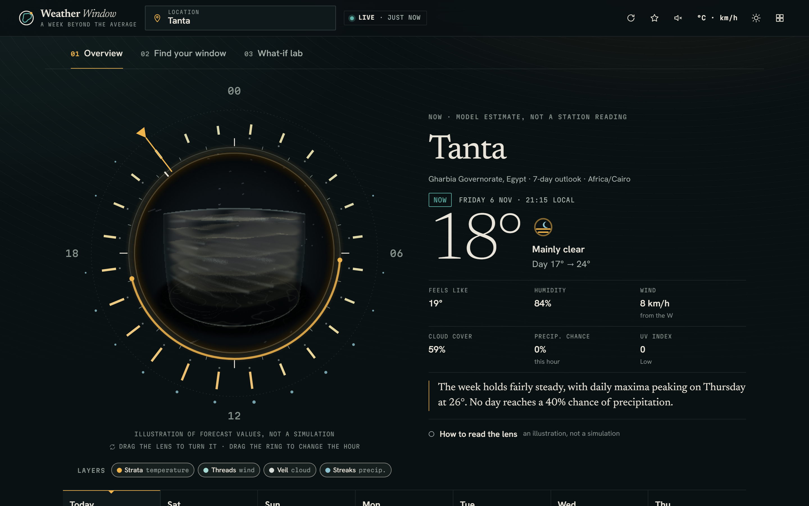

# Weather Window

**A week beyond the average.**

Weather Window turns a seven-day forecast into something you can understand, plan around and experiment with. Its central question: *does the average tell the whole story?*

> The forecast tells you what might happen. Weather Window helps you understand what the week could feel like.



**Status:** working static web app, version 3.1.0. Automated tests pass using fixture data (recorded-shape sample responses, not live network calls). A manual live API test on Windows on November 6, 2026 succeeded: the app made real city-search and forecast requests to Open-Meteo, both returned HTTP 200, and it displayed a real forecast marked LIVE. It is not deployed yet. See [Tests](#tests) and [Known limitations](#known-limitations).

## What it does

| Section | What you can do |
|---|---|
| **01 Overview** | Look through **the lens**: a 3D glass air column whose colour, drifting threads, cloud veil, falling streaks and light follow the selected hour's temperature, wind speed and direction, cloud cover, precipitation chance and UV ("How to read the lens" lists every mapping). Turn it by dragging. Turn the **day dial** around it (or use the arrow keys) to move through the hours; the readout, chart marker and hourly table follow. Scan seven days on one temperature scale, explore all 168 hours on one chart (click any hour to see it in the lens), peel the lens into layers, read the week as a **thermal relief** (a loupe shows the true hourly values underneath), watch the selected day's **living wind** hour by hour, compare **seven day portraits** generated from each day's forecast, trace each day against the week's average in **the week's signature**, download it as a PNG card, open any day's details and read data-checked insights. |
| **02 Find your window** | Pick a profile (walk, bike ride, outdoor study, run) or set your own limits for temperature, humidity, wind, precipitation chance and UV, a local-time interval (overnight supported) and a minimum duration. A 7×24 grid shows every hour's status; ranked windows explain why they rank where they do, show where they sit in the day and open in the lens; any hour can be inspected check by check; two windows can be compared; when nothing fits, the app says so and offers the smallest single change that would open a window. The plan can be copied as text. |
| **03 What-if lab** | Two synthetic weeks with the same mean daily maximum (25 °C). Drag individual days (optionally keeping the mean fixed), shift or stretch a whole week, change the comfort band, or start from a hypothetical copy of the real forecast. A balance-beam view shows the mean as the balance point, "Same circle, different shapes" shows both weeks around their means, a statistics table marks which numbers stay the same and which differ; every change animates and leaves a dashed "before" line; a 60-second guided experiment is built in. |

Also: city search and opt-in geolocation, saved places, metric/imperial units, dark/light themes, CSV export with provenance, an optional generated sound layer (off by default, every visit), presentation mode (larger type, keys **1 2 3** switch sections), a privacy panel with "clear everything", and clear labels for **Live / Cached / Stale / Expired / Synthetic** data.

## Identity in one paragraph

*The Aperture.* The circle is the average; the contour that wanders off it is the real week. That figure is the logo, the week signature, the lab's shapes and the lens itself. Newsreader for display, Hanken Grotesk for interface, Martian Mono for scales and data; basalt and limestone with petrol (fits), solar (the selection index, sun, heat), glacier (cool, wet) and oxide (warnings). Plates carry registration ticks, selection is always marked by the solar index, motion drifts and focuses in. Condition glyphs are an original family drawn in the same vocabulary. Every artistic view labels what is forecast, derived and artistic. Details and reasons: `DECISIONS.md` D9–D19.

## Run it locally

Requirements: Python 3.8 or newer. `serve.py` uses only the Python standard library, so there is nothing to install.

In PowerShell (Windows), from the project folder:

```powershell
python serve.py               # opens http://127.0.0.1:8765 (next free port if busy)
python serve.py --port 9000   # choose a port
```

On macOS or Linux the commands are the same (use `python3` if `python` is not found). Stop the server with Ctrl+C.

ES modules do not load from `file://`, so double-clicking `index.html` will not work; use `serve.py` or any static server.

## Tests

There are two kinds of tests. Both use fixtures: Open-Meteo is never called, so the results are deterministic and work offline.

| Suite | File | What the number counts | Last result |
|---|---|---|---|
| Unit tests | `tests/core.test.js` | 32 separate `node:test` test cases (they contain 171 `assert` calls in total) | 32 / 32 passed |
| Browser smoke test | `tests/browser.mjs` | 67 named checks inside one Playwright script that drives the real page in Chromium | 67 / 67 passed, 0 console errors or warnings |

The results above are from runs on 2026-11-06: both suites on Linux (Node 22), and the unit suite again on Windows (Node 24), where all 32 also passed.

**Unit tests.** Need Node.js 20 or newer. No packages to install.

```powershell
npm test                         # same as: node --test tests/core.test.js
```

**Browser smoke test (optional).** Also needs the Playwright package and its Chromium browser. Install them once from the project folder (they go into `node_modules/`, which git ignores):

```powershell
npm install --no-save playwright
npx playwright install chromium
```

Then use two PowerShell windows, both in the project folder:

```powershell
# window 1: start the site without opening a browser
python serve.py --no-browser

# window 2: run the checks against it
npm run test:browser             # same as: node tests/browser.mjs http://127.0.0.1:8765/
```

Add a folder name after the URL (for example `node tests/browser.mjs http://127.0.0.1:8765/ shots`) to save full-page screenshots there. Those screenshots show fixture data, not real forecasts.

The browser test covers navigation, search (including an HTML-injection attempt in a result), live/cached/failed-refresh states, the planner (including a no-match case and relaxation), the lab (shift, keep-mean dragging by keyboard and pointer), units, theme, CSV export, persistence, clearing data, blocked storage, reduced motion, horizontal overflow at 390 px, the WebGL lens and its 2D fallback, dial keyboard control, back-to-now, the sound default and the signature PNG. Chromium is launched with SwiftShader so WebGL works without a GPU.

## Project structure

```
index.html              page shell, metadata, CSP
serve.py                local server with port fallback (stdlib only)
src/main.js             app shell: state, loading, header, routing
src/data/api.js         Open-Meteo requests (timeouts, cancellation, typed errors)
src/core/               pure, tested logic — no DOM
  normalize.js          response validation → forecast model (nulls, never zeros)
  time.js               IANA-timezone handling (DST-safe)
  stats.js              mean, range, population SD, day-to-day change
  matcher.js            Find-your-window engine, ranking, relaxations
  encoding.js           forecast hour → lens parameters + legend (the only data→visual mapping)
  insights.js           weekly insights and story
  lab.js                What-if scenarios
  freshness.js csv.js storage.js units.js weathercodes.js demo.js num.js
src/ui/                 views and visualisations
  lens.js               WebGL lens (shader, adaptive quality, fallbacks)
  dial.js instrument.js day dial and the lens/dial composition
  signature.js          week signature, lab shapes, PNG card, brand-mark contour
  thermal.js            thermal relief + loupe
  wind.js               living wind tiles
  portraits.js          seven day portraits
  icons.js              UI icons and the aperture weather glyphs
  sound.js              optional generated sound
  sky.js                2D fallback illustration
src/styles/app.css      design tokens and components
assets/                 self-hosted fonts (OFL), icons, social image
tests/                  unit tests, fixtures, browser smoke test
_headers netlify.toml   static-host security headers
DECISIONS.md            architecture and product decisions, limitations
CHANGELOG.md
```

## Data and honesty rules

* **Source:** [Open-Meteo](https://open-meteo.com/) forecast and geocoding APIs, CC BY 4.0, free for non-commercial use (under 10,000 calls/day). No API key.
* **Current conditions** are labelled as model estimates, not station readings.
* **Missing values** are shown as "—", excluded from calculations, counted in a banner, and never treated as zero.
* **Precipitation probability** (chance of >0.1 mm in an hour) and **precipitation sum** (mm) are always shown as different things.
* **Daily maxima/minima** are described as peaks, not all-day temperatures.
* **Synthetic data** (demo week, lab presets) is labelled everywhere it appears, and the demo planner uses a fixed reference "now".
* **Planner thresholds** are presented as personal preferences, not health or safety limits.
* **UV** categories follow the [WHO UV index guidance](https://www.who.int/news-room/questions-and-answers/item/radiation-the-ultraviolet-(uv)-index).

## Privacy

No accounts, analytics, cookies or trackers. Settings, saved places and up to four recent forecasts are kept in this browser's `localStorage` (validated on every read; the page works if storage is blocked). City searches and coordinates rounded to 0.01° (~1 km) are sent to Open-Meteo. Geolocation is only requested when the visitor presses "Use my location".

## Deploy (static hosting, no build step)

The site is plain static files. Any static host works.

**Netlify (drag and drop):** go to app.netlify.com → *Add new site* → *Deploy manually* → drop the `weather-window-web` folder. `_headers` applies the security headers.

**Cloudflare Pages:** *Create* → *Pages* → *Upload assets* → upload the folder. `_headers` is honoured.

**GitHub Pages:** push the folder's contents to a repository, then *Settings* → *Pages* → deploy from the branch root. GitHub Pages ignores `_headers`; the CSP in `index.html` still applies.

After deploying, change `og:image` in `index.html` to the absolute URL (e.g. `https://your-site/assets/og-image.png`) so social previews work.

Open-Meteo's free API is for non-commercial use. A commercial deployment needs an Open-Meteo plan.

## How it was built

Weather Window is an individual project. I own it and I am responsible for its development: I set its direction and features, made the design and implementation decisions, and reviewed and tested the results.

The initial idea and the central question, *does the average tell the whole story?*, took shape in brainstorming with my university classmates. Their part was that early exchange of ideas; the app itself was developed independently.

I used Claude, an AI model made by Anthropic, as a coding assistant. Claude generated a large part of the code under my direction and review. The main decisions and the reasons for them are recorded in `DECISIONS.md`.

## What I learned

* **Missing is not zero.** An earlier version rejected the whole forecast if a single hourly value was missing. Now a missing value is shown as "—", left out of every calculation and counted in a banner.
* **A day is not always 24 hours.** On a daylight-saving change a local day has 23 or 25 hours, so all time logic uses Unix timestamps and the IANA timezone. One unit test exists only to check a 25-hour day.
* **Label what is real.** Every artistic view says which parts are forecast, derived or artistic.

## Known limitations

* Open-Meteo's own daily aggregates use the timezone offset in force when the request was made, so on a daylight-saving changeover day a daily max/min can be off by one hour's data. Hourly data and all of Weather Window's own grouping are DST-correct.
* The automated unit and browser tests use fixtures shaped like Open-Meteo's documented responses and do not call Open-Meteo. A separate manual live API smoke test succeeded on Windows on November 6, 2026. Broader testing across conditions and verification after deployment are still outstanding.
* The lens is an illustration of a few model values for one hour, not imagery, radar or a simulation; its strata and column are a visual language, not air layers. Humidity is deliberately not encoded.
* The 3D lens needs WebGL; without it (or if the GPU context is lost) a labelled 2D illustration is shown. Performance was tuned on a software renderer; real-device frame rates are untested.
* Thermal relief colours between forecast rows are a blend; the living wind, portraits and lens are artistic renderings of forecast values with their mappings stated on screen. None of them is a map or a measurement.
* The sound layer depends on Web Audio and a user gesture; it is never needed to understand the page.
* Interface language is English only.

## License

The code is released under the MIT License; see [`LICENSE`](LICENSE). In short, anyone may use, copy, modify, merge, publish, distribute, sublicense and sell copies of the software, on the condition that the copyright notice and the permission notice are included in all copies or substantial portions of it. The software is provided "as is", without warranty of any kind, and the authors are not liable for claims or damages arising from its use. The `LICENSE` file is the binding text.

Exceptions: the fonts in `assets/fonts/` (Newsreader, Hanken Grotesk, Martian Mono) are under the SIL Open Font License 1.1, with their license files next to them. Weather data is not stored in this repository; the app fetches it from Open-Meteo at runtime, under Open-Meteo's own terms (see [Data and honesty rules](#data-and-honesty-rules)).
